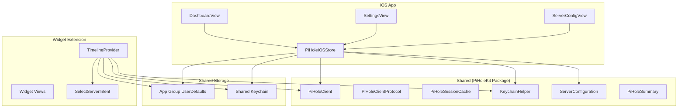

# feat: Add iOS companion app with widgets

## Overview

Add an iOS target and WidgetKit extension to the existing PiHoleControls Xcode project. Extract shared business logic into a local Swift Package (`PiHoleKit`), build iOS-specific UI with SwiftUI + NavigationStack, and add home screen / lock screen widgets. Supports multiple Pi-hole instances with per-server control, stats dashboard, and dual v5/v6 API support.

---

## Problem Frame

The macOS menu bar app is only accessible from the Mac. Pi-hole control is most useful when always available — from the couch, on mobile data via Tailscale/WireGuard, or anywhere away from the desk. An iOS companion app with widgets provides at-a-glance status and quick toggling from the phone. (see origin: `docs/brainstorms/ios-companion-app-requirements.md`)

---

## Requirements Trace

- R1. Toggle Pi-hole blocking (enable/disable/timed disable) per-server from iOS
- R2. Stats dashboard: queries today, blocked today, block percentage, top blocked domain
- R3. Settings: add/edit/delete Pi-hole servers, connection test, default disable duration
- R4. Home screen widgets (small: status + blocked count; medium: + block % + top blocked)
- R5. Lock screen widget (blocking status indicator)
- R6. Pi-hole v5 + v6 dual-API support (same as macOS)
- R7. Multiple Pi-hole instances with per-server independent toggle
- R8. Credentials stored securely in Keychain, shared with widget via access group
- R9. Widget refreshes via live API call with cached fallback

---

## Scope Boundaries

- No relay server or cloud proxy — direct API communication only
- No Pi-hole administration (groups, DHCP, DNS settings)
- No App Store distribution in v1 (personal use, ad-hoc/TestFlight)
- No query log browsing, push notifications, Apple Watch, or Shortcuts (deferred)

### Deferred to Follow-Up Work

- Port temp domain allowlist from `feat/temp-domain-allowlist` branch
- macOS app migration to use PiHoleKit package (keep working as-is for now)
- macOS multi-instance support (separate effort)

---

## Context & Research

### Relevant Code and Patterns

- `PiHoleControls/PiHoleClient.swift` — Platform-agnostic API client (Foundation + CryptoKit only). Tries v6 first, falls back to v5 on 404. Extracted `requestV6WithAuthFallback()` and `performV6Mutation()` handle auth cascade
- `PiHoleControls/PiHoleClientProtocol.swift` — Protocol with `fetchStatus`, `enableBlocking`, `disableBlocking`
- `PiHoleControls/PiHoleStore.swift` — `@MainActor` ObservableObject. Single-instance: flat `host`/`token` in AppStorage/Keychain. Timer-based countdown. `ClientFactory` closure for DI
- `PiHoleControls/KeychainHelper.swift` — Uses Security framework directly. Service: `com.littleappventures.PiHoleControls`. No access group currently
- `PiHoleControls/PiHoleSessionCache.swift` — Swift actor, single-entry, hash-keyed. In-memory only
- `PiHoleControlsTests/Mocks/MockPiHoleClient.swift` — Call tracking + configurable responses

### External References

- WidgetKit `AppIntentTimelineProvider` (iOS 17+) for configurable widget with server selection
- Widget refresh budget: ~40-70/day in production. Use `.after(15min)` minimum + `WidgetCenter.shared.reloadTimelines()` on app toggle actions
- `kSecAttrAccessGroup` for shared Keychain between app and widget extension
- `@Observable` (iOS 17+) preferred over `ObservableObject` for new iOS code

---

## Key Technical Decisions

- **Local Swift Package (`PiHoleKit`)**: Xcode 26 uses synced root groups (directory-based membership). Sharing files across targets via checkboxes is not possible with synced groups. A local Swift Package is the natural approach — it enforces that shared code never imports platform frameworks, has its own test target, and all three targets (macOS, iOS, widget) depend on it. *Rejected alternatives:* shared framework target (adds signing complexity and launch-time overhead for widget embedding), symlinks/copy scripts (fragile, defeats incremental builds). *Tradeoff:* all shared types become `public`, expanding the maintained API surface — a one-way door once iOS and widget depend on these interfaces. Declare `PiHoleClientProtocol: Sendable` and address the static mutable `selfSignedSessions` dictionary (convert to actor or `nonisolated(unsafe)` with lock) before it becomes public API under strict concurrency
- **`@Observable` for iOS store**: iOS 17+ target means we can use `@Observable` instead of `ObservableObject`. The macOS `PiHoleStore` stays on `ObservableObject` because `StatusItemController` observes it via Combine `sink` pipelines — `@Observable` does not emit Combine publishers, so migration would require rewriting all AppKit observation code. To avoid duplicating retry/error logic across two stores, extract shared store utilities (retry with backoff, error formatting, client lifecycle) into PiHoleKit as non-UI helpers that both platform stores delegate to
- **`ServerConfiguration` model in App Group UserDefaults, tokens in shared Keychain**: Configs are Codable structs stored as JSON array in `UserDefaults(suiteName:)`. Tokens stored in Keychain keyed by server UUID, using shared access group. Never store tokens in UserDefaults. All new fields must use `decodeIfPresent` with defaults for forward-compatible schema evolution. *Rejected:* SwiftData/Core Data — unnecessary framework weight and migration complexity for fewer than 10 server configs
- **Upgrade `PiHoleSessionCache` to dictionary-based**: Current single-entry cache will thrash on every server switch in multi-server mode (authenticating server A evicts server B's session). Upgrade to `[String: CachedSession]` dictionary keyed by session hash. Small change (~5 lines) with high value for multi-server
- **`AppIntentTimelineProvider` for widgets**: Lets user pick which server to show via widget configuration intent. Falls back to first configured server if unconfigured. Only viable approach for configurable widgets on iOS 17+ (IntentTimelineProvider is deprecated, StaticConfiguration has no server selection)
- **Date-based countdown on iOS**: iOS suspends timers on background. Store `disableEndDate` as absolute `Date` and recompute remaining seconds on foreground via `scenePhase`. *Invariant:* on foreground, if `Date() >= disableEndDate`, call `fetchStatus` to confirm the server re-enabled blocking rather than optimistically setting `isBlocking = true` — the server may not have re-enabled if it was unreachable
- **Per-server toggle**: Each server toggled independently from its dashboard view. No "toggle all" behavior. *Rationale:* "toggle all" creates partial-failure ambiguity (if 2 of 3 servers succeed, what state is shown?), users with multiple Pi-holes often serve different network segments, and transaction semantics for batch operations are not worth the complexity in v1
- **Widget timeout**: 10-second timeout applies to the combined fetch operation (fetchStatus + fetchSummary), not per-call. With v6-first-v5-fallback and auth cascade, worst case chains many round-trips — a per-call timeout could blow past WidgetKit's ~30s wall-clock budget
- **Keychain scope**: Existing macOS Keychain items (created without `kSecAttrAccessGroup`) remain in the macOS app's own scope and are not shared with iOS/widget. Only new multi-server tokens created through PiHoleKit's enhanced KeychainHelper use the shared access group. This is intentional — macOS migration to PiHoleKit is deferred

---

## Open Questions

### Resolved During Planning

- **Per-server vs all-at-once toggle**: Per-server (user decision)
- **Widget server selection**: Use AppIntentConfiguration so user picks which server to display
- **First-launch empty state**: Dashboard with illustration, explanatory text, and "Add Your Pi-hole" button navigating to ServerConfigView
- **Countdown on iOS**: Date-based (store end timestamp, recompute on foreground)
- **Widget stale data**: Show cached data with "Last updated" subtitle. If no cached data, show "Open app to configure" placeholder
- **Code sharing mechanism**: Local Swift Package (PiHoleKit) — forced by Xcode 26 synced groups

### Deferred to Implementation

- Exact v5/v6 stats response JSON shapes — need to inspect real API responses
- Whether `PiHoleSessionCache` needs persistence or if per-launch re-auth is acceptable on iOS (likely fine — auth is a single request)
- Maximum number of server configs to support (start uncapped, add limit if UI breaks)

---

## Output Structure

```
PiHoleControls/
├── PiHoleKit/                           # Local Swift Package (shared code)
│   ├── Package.swift
│   ├── Sources/PiHoleKit/
│   │   ├── PiHoleClient.swift           # Moved from PiHoleControls/
│   │   ├── PiHoleClientProtocol.swift   # Moved from PiHoleControls/
│   │   ├── PiHoleSessionCache.swift     # Moved from PiHoleControls/
│   │   ├── KeychainHelper.swift         # Moved + access group support
│   │   ├── ServerConfiguration.swift    # New: multi-server config model
│   │   └── PiHoleSummary.swift          # New: stats response models
│   └── Tests/PiHoleKitTests/
│       ├── PiHoleClientTests.swift      # Moved from PiHoleControlsTests/
│       ├── PiHoleSessionCacheTests.swift
│       ├── KeychainHelperTests.swift
│       └── ServerConfigurationTests.swift
├── PiHoleControls/                      # macOS target (existing, mostly unchanged)
│   ├── PiHoleControlsApp.swift
│   ├── PiHoleStore.swift
│   ├── ContentView.swift
│   ├── SettingsView.swift
│   └── StatusItemController.swift
├── PiHoleControlsiOS/                   # iOS target (new)
│   ├── PiHoleControlsiOSApp.swift
│   ├── PiHoleIOSStore.swift             # iOS-specific store (@Observable, multi-server)
│   ├── DashboardView.swift
│   ├── SettingsView.swift
│   ├── ServerConfigView.swift
│   └── Assets.xcassets/
├── PiHoleWidget/                        # WidgetKit extension (new)
│   ├── PiHoleWidget.swift               # Widget definition + timeline provider
│   ├── PiHoleWidgetEntry.swift          # Timeline entry model
│   ├── PiHoleWidgetViews.swift          # Small, medium, lock screen views
│   ├── SelectServerIntent.swift         # AppIntent for server selection
│   └── Assets.xcassets/
├── PiHoleControls.xcodeproj/
└── PiHoleControls.entitlements          # Shared entitlements (App Group + Keychain)
```

---

## High-Level Technical Design

> *This illustrates the intended approach and is directional guidance for review, not implementation specification. The implementing agent should treat it as context, not code to reproduce.*



**Data flow for widget refresh:**
1. Widget timeline fires → TimelineProvider reads server config from App Group UserDefaults
2. Reads API token from shared Keychain (via access group)
3. Makes live API call (10s timeout) using PiHoleClient
4. On success: creates entry with live data, writes cache to App Group
5. On failure: reads cached status from App Group, creates entry with stale indicator
6. Returns timeline with `.after(15 minutes)` policy

**Data flow for app toggle:**
1. User taps toggle → PiHoleIOSStore calls PiHoleClient.enableBlocking/disableBlocking
2. On success: updates @Observable state, writes status to App Group UserDefaults
3. Calls `WidgetCenter.shared.reloadTimelines(ofKind:)` to trigger widget refresh

---

## Implementation Units

### Phase 1: Foundation (PiHoleKit Package + Xcode Setup)

- [ ] U1. **Create PiHoleKit local Swift Package**

**Goal:** Extract shared business logic into a local Swift Package that both macOS, iOS, and widget targets can depend on.

**Requirements:** R6, R8

**Dependencies:** None

**Files:**
- Create: `PiHoleKit/Package.swift`
- Create: `PiHoleKit/Sources/PiHoleKit/` (directory)
- Move: `PiHoleControls/PiHoleClient.swift` → `PiHoleKit/Sources/PiHoleKit/PiHoleClient.swift`
- Move: `PiHoleControls/PiHoleClientProtocol.swift` → `PiHoleKit/Sources/PiHoleKit/PiHoleClientProtocol.swift`
- Move: `PiHoleControls/PiHoleSessionCache.swift` → `PiHoleKit/Sources/PiHoleKit/PiHoleSessionCache.swift`
- Move: `PiHoleControls/KeychainHelper.swift` → `PiHoleKit/Sources/PiHoleKit/KeychainHelper.swift`
- Modify: `PiHoleControls.xcodeproj/project.pbxproj` (add local package dependency)
- Modify: `PiHoleControls/PiHoleStore.swift` (import PiHoleKit)

**Approach:**
- Package.swift targets macOS 14+ and iOS 17+, depends only on Foundation + CryptoKit + Security
- All moved types must become `public` (currently internal). Audit access control. Declare `PiHoleClientProtocol: Sendable`
- Address `PiHoleClient.selfSignedSessions` static mutable dictionary — convert to actor or `nonisolated(unsafe)` with lock for strict concurrency compliance
- Upgrade `PiHoleSessionCache` from single-entry to dictionary-based `[String: CachedSession]` keyed by existing session hash (SHA256 of host+token) to support multi-server without session thrashing. This is distinct from the widget cache key (`widgetCache-{serverUUID}`) — session cache stores auth sessions, widget cache stores display data
- macOS target adds PiHoleKit as a local package dependency
- macOS app must still compile and run identically after this extraction
- Move existing tests to `PiHoleKit/Tests/PiHoleKitTests/`

**Patterns to follow:**
- Standard Swift Package layout with Sources/ and Tests/
- Existing `PiHoleClientProtocol` pattern for testability

**Test scenarios:**
- Happy path: macOS app builds and runs after extraction, all existing tests pass from PiHoleKitTests target
- Happy path: PiHoleKit package compiles for both macOS and iOS destinations
- Edge case: verify no AppKit or UIKit imports leaked into the package (build for iOS should catch this)

**Verification:**
- `xcodebuild build -scheme PiHoleControls -destination "platform=macOS"` succeeds
- `swift build` in PiHoleKit/ succeeds
- All existing tests pass

---

- [ ] U2. **Add ServerConfiguration model and multi-server persistence**

**Goal:** Define the data model for multiple Pi-hole server configurations and persist them in App Group UserDefaults with tokens in shared Keychain.

**Requirements:** R7, R8

**Dependencies:** U1

**Files:**
- Create: `PiHoleKit/Sources/PiHoleKit/ServerConfiguration.swift`
- Modify: `PiHoleKit/Sources/PiHoleKit/KeychainHelper.swift` (add access group parameter)
- Create: `PiHoleKit/Tests/PiHoleKitTests/ServerConfigurationTests.swift`

**Approach:**
- `ServerConfiguration`: Codable struct with `id: UUID`, `name: String`, `host: String`, `allowSelfSignedCert: Bool`. Token stored in Keychain keyed by `"apiToken-\(id.uuidString)"`
- `ServerConfigurationStore`: class that manages an array of `ServerConfiguration` in `UserDefaults(suiteName:)` App Group suite. Tests use a test-specific suite name (no App Group entitlement needed for unit tests)
- Add optional `accessGroup: String?` parameter to `KeychainHelper.save/retrieve/delete` methods. Default nil preserves backward compatibility for macOS
- App Group identifier: `group.com.littleappventures.PiHoleControls`

**Patterns to follow:**
- Existing `KeychainHelper` API style (static methods, throws on save)
- Codable JSON serialization pattern

**Test scenarios:**
- Happy path: create ServerConfiguration, encode to JSON, decode back — round-trip preserves all fields
- Happy path: ServerConfigurationStore add/remove/update servers persists to UserDefaults
- Happy path: KeychainHelper save/retrieve with access group parameter works
- Happy path: KeychainHelper save/retrieve without access group still works (backward compat)
- Edge case: delete last server returns to empty state
- Edge case: ServerConfiguration with empty host fails validation
- Edge case: deleting a server also removes its Keychain token
- Edge case: loading from UserDefaults with missing/corrupt data returns empty array gracefully

**Verification:**
- All ServerConfiguration tests pass
- KeychainHelper backward compatibility verified (existing macOS tests still pass)

---

- [ ] U3. **Add stats/summary API to PiHoleClient**

**Goal:** Add `fetchSummary()` method to PiHoleClientProtocol and implement for both v5 and v6 APIs.

**Requirements:** R2, R6

**Dependencies:** U1

**Files:**
- Modify: `PiHoleKit/Sources/PiHoleKit/PiHoleClientProtocol.swift` (add fetchSummary)
- Modify: `PiHoleKit/Sources/PiHoleKit/PiHoleClient.swift` (implement fetchSummary)
- Create: `PiHoleKit/Sources/PiHoleKit/PiHoleSummary.swift` (response model)
- Modify: `PiHoleKit/Tests/PiHoleKitTests/PiHoleClientTests.swift` (pre-existing from U1 move)

**Approach:**
- `PiHoleSummary` struct: `queriesToday: Int`, `blockedToday: Int`, `blockPercentage: Double`, `topBlockedDomain: String?`
- v6 endpoint: `GET /api/stats/summary` (uses existing auth cascade via `requestV6WithAuthFallback`)
- v5 endpoint: `GET /admin/api.php?summaryRaw&auth=TOKEN` (fallback on 404)
- Follow existing `fetchStatus` pattern for v6-first-v5-fallback
- Add `fetchSummary()` to `PiHoleClientProtocol` with default extension
- Update `MockPiHoleClient` with `summaryToReturn` and call tracking

**Files (additional):**
- Modify: `PiHoleControlsTests/Mocks/MockPiHoleClient.swift` (add fetchSummary mock)

**Patterns to follow:**
- Existing `fetchStatus` method in PiHoleClient for v6/v5 fallback pattern
- Existing `requestV6WithAuthFallback` for auth cascade

**Test scenarios:**
- Happy path: fetchSummary returns parsed PiHoleSummary with all fields populated
- Happy path: MockPiHoleClient tracks fetchSummary calls and returns configured response
- Edge case: PiHoleSummary decodes when topBlockedDomain is missing/null
- Edge case: v6 summary returns 404, falls back to v5 summaryRaw endpoint
- Error path: both v6 and v5 fail, throws appropriate error

**Verification:**
- PiHoleClientProtocol has fetchSummary method
- MockPiHoleClient conforms with new method
- Unit tests pass

---

- [ ] U4. **Create iOS target and Xcode project configuration**

**Goal:** Add an iOS app target to the existing Xcode project with proper entitlements, App Group, and Keychain sharing.

**Requirements:** R1, R7, R8

**Dependencies:** U1, U2

**Files:**
- Create: `PiHoleControlsiOS/` (directory with synced root group)
- Create: `PiHoleControlsiOS/PiHoleControlsiOSApp.swift`
- Create: `PiHoleControlsiOS/Assets.xcassets/`
- Create: `PiHoleControlsiOS/PiHoleControlsiOS.entitlements`
- Modify: `PiHoleControls.xcodeproj/project.pbxproj`

**Approach:**
- Add iOS target via Xcode (or manually in pbxproj): bundle ID `com.littleappventures.PiHoleControls.ios`, iOS 17.0 deployment target
- Enable App Groups entitlement: `group.com.littleappventures.PiHoleControls`
- Enable Keychain Sharing: access group `$(AppIdentifierPrefix)com.littleappventures.PiHoleControls.shared`
- Add PiHoleKit as a dependency
- Minimal app entry point: `@main struct` with empty ContentView placeholder
- Same development team (`G8V784C2XL`)

**Test expectation:** none — scaffolding only, verified by successful build

**Verification:**
- iOS target builds for iPhone simulator
- App launches on simulator and shows placeholder view

---

### Phase 2: iOS App Core (Store + Dashboard + Settings)

- [ ] U5. **Build PiHoleIOSStore (multi-server, iOS lifecycle)**

**Goal:** Create the iOS-specific store that manages multiple server configurations, per-server blocking state, stats, and iOS lifecycle handling.

**Requirements:** R1, R2, R7

**Dependencies:** U2, U3, U4

**Files:**
- Create: `PiHoleControlsiOS/PiHoleIOSStore.swift`
- Create: `PiHoleControlsiOS/Tests/PiHoleIOSStoreTests.swift` (or in PiHoleControlsTests if shared test target)

**Approach:**
- `@Observable @MainActor` class, not ObservableObject
- Holds a `ServerConfigurationStore` for managing server list
- Per-server state: `[UUID: ServerState]` dictionary where `ServerState` has `isBlocking: Bool?`, `isLoading: Bool`, `lastError: String?`, `summary: PiHoleSummary?`, `disableEndDate: Date?`
- iOS `ClientFactory` takes `ServerConfiguration` (not raw strings) to enable per-server mock injection in tests
- Creates ephemeral `PiHoleClient` per server using stored config + Keychain token
- `refreshServer(_ id: UUID)` — fetches status + summary for one server
- `toggleBlocking(server: UUID)` — enable/disable per-server
- `disableBlocking(server: UUID, durationSeconds: Int?)` — timed disable with Date-based end time
- Countdown: store `disableEndDate` as `Date`. Compute `remainingSeconds` as computed property. On `scenePhase == .active`, refresh from server if past end date
- Auto-refresh: refresh active server on foreground, no background polling (battery)
- After any toggle/disable: write cached status to App Group UserDefaults key `widgetCache-{serverUUID}` as JSON with `isBlocking`, `summary`, and `timestamp` fields, then call `WidgetCenter.shared.reloadTimelines(ofKind:)`
- Retry with exponential backoff (same pattern as macOS store). Inject `baseRetryDelay: 0` in tests for instant retries
- Connection test method (same as macOS)
- Wrap `WidgetCenter` behind a closure/protocol for testability

**Patterns to follow:**
- macOS `PiHoleStore` for retry logic, error handling, and client factory pattern
- `@Observable` pattern (not @Published)
- macOS `PiHoleStoreTests` pattern: `makeStore(mockClient:)` with `baseRetryDelay: 0`

**Test scenarios:**
- Happy path: refreshServer fetches status and summary, updates per-server state with correct values
- Happy path: refreshServer passes correct host, token, and allowSelfSignedCert from ServerConfiguration to clientFactory
- Happy path: toggleBlocking enables blocking when disabled (calls enableBlocking on client)
- Happy path: toggleBlocking disables blocking when enabled (calls disableBlocking on client)
- Happy path: disableBlocking with duration 300 sets disableEndDate to ~5 minutes from now
- Happy path: disableBlocking with nil duration sets isBlocking false with no disableEndDate
- Happy path: after successful toggle, App Group UserDefaults key `widgetCache-{serverUUID}` contains JSON with isBlocking, summary, and timestamp within 1s of now
- Happy path: after successful toggle, reloadTimelines closure is called with the widget kind string
- Happy path: testConnection for reachable server returns .success
- Edge case: toggleBlocking while server isLoading is no-op — no API calls made
- Edge case: toggleBlocking when server status is nil triggers refreshServer, not enable/disable
- Edge case: refresh server that doesn't exist in config is no-op
- Edge case: timed disable end date in past → treats as expired, calls fetchStatus to confirm server state
- Edge case: multiple servers refreshed concurrently don't interfere with each other's state
- Error path: API error sets per-server lastError, doesn't affect other servers' state
- Error path: after 3 failed attempts with baseRetryDelay: 0, lastError contains final error and mock fetchStatusCallCount equals 3
- Error path: testConnection for unreachable server returns .failure with error message

**Verification:**
- All store tests pass with baseRetryDelay: 0 (no real delays)
- Store correctly manages independent per-server state

---

- [ ] U6. **Build DashboardView**

**Goal:** Create the main iOS screen showing blocking status, toggle, and stats for the selected server.

**Requirements:** R1, R2, R7

**Dependencies:** U5

**Files:**
- Create: `PiHoleControlsiOS/DashboardView.swift`

**Approach:**
- Server picker at top: if 1 server, show name. If 2+, show Picker (menu style for 3+, segmented for 2)
- Large shield icon: green (enabled), red (disabled), gray (unknown/loading)
- Toggle button: "Disable Blocking" / "Enable Blocking" with loading state
- Timed disable: long-press or secondary action to choose duration
- If disabled with timer: show countdown (computed from `disableEndDate - now`, updates via TimelineView)
- Stats cards row: three cards (Queries Today, Blocked Today, Block %)
- Top blocked domain shown below stats
- Pull-to-refresh triggers `store.refreshServer()`
- Error banner at top when `lastError` is set
- Empty state when no servers: illustration + "Add Your Pi-hole" button → navigates to ServerConfigView
- Refresh on `scenePhase == .active`

**Patterns to follow:**
- macOS ContentView for status/toggle layout concepts (adapted for full-screen iOS)
- Standard iOS pull-to-refresh (`.refreshable {}`)

**Test scenarios:**
- Happy path: when server.isBlocking is true, shield icon is green and toggle button reads "Disable Blocking"
- Happy path: when server.isBlocking is false, shield icon is red and toggle button reads "Enable Blocking"
- Happy path: toggle button triggers store.toggleBlocking with the active server's UUID
- Happy path: pull-to-refresh calls store.refreshServer with the active server's UUID
- Happy path: stats cards show queriesToday, blockedToday, and blockPercentage from server summary
- Edge case: empty state shown when no servers configured — illustration + "Add Your Pi-hole" button navigates to ServerConfigView
- Edge case: when server.isBlocking is nil, shield icon is gray with unknown state
- Edge case: while server.isLoading is true, toggle button is disabled and shows progress indicator
- Edge case: when server.lastError is non-nil, error banner is visible with the error text
- Edge case: when server summary is nil, stats cards show placeholder dashes
- Edge case: countdown display updates via TimelineView when timed disable is active
- Edge case: with exactly 2 servers, picker renders as segmented control; with 3+ servers, picker renders as menu style
- Edge case: server picker switches active server and triggers refreshServer
- Edge case: long-press on toggle button presents duration picker with options matching defaultDisableMinutes

**Verification:**
- Dashboard renders correctly on iPhone simulator in both light and dark mode
- Toggle, pull-to-refresh, and server switching work end-to-end

---

- [ ] U7. **Build SettingsView and ServerConfigView**

**Goal:** Create settings screen with server list management and server configuration form.

**Requirements:** R3, R7

**Dependencies:** U5

**Files:**
- Create: `PiHoleControlsiOS/SettingsView.swift`
- Create: `PiHoleControlsiOS/ServerConfigView.swift`

**Approach:**
- SettingsView: NavigationStack destination with List
  - Section: "Servers" — list of configured servers with swipe-to-delete, tap to edit, "Add Server" button
  - Section: "Options" — default disable duration picker (5/10/15/30 min or indefinite)
  - Section: "About" — app version
  - Delete confirmation alert for last remaining server
- ServerConfigView: Form with fields
  - Display name (TextField)
  - Host (TextField, keyboard type .URL)
  - API Token (SecureField)
  - Self-signed certificate toggle
  - "Test Connection" button (same pattern as macOS: calls fetchStatus(allowLegacyFallback: false))
  - Save/Cancel toolbar buttons
- Navigation: from Dashboard gear icon → Settings, from Settings server row → ServerConfigView

**Patterns to follow:**
- macOS SettingsView for field layout and connection test pattern
- Standard iOS Form/List conventions

**Test scenarios:**
- Happy path: add new server with valid host/token, test succeeds, server appears in list
- Happy path: edit existing server, changes persist and server UUID is preserved
- Happy path: delete server via swipe, server removed from list and Keychain token deleted
- Happy path: while connection test is in progress, button shows spinner and is disabled
- Happy path: successful connection test shows green checkmark/success indicator
- Edge case: save with empty host shows validation error
- Edge case: save with empty token shows validation error
- Edge case: test connection failure shows error message
- Edge case: tapping Cancel on ServerConfigView discards all field changes — no server saved or modified
- Edge case: delete last server shows confirmation alert; dismissing alert preserves the server
- Edge case: server list rows do not display the API token
- Edge case: host field with trailing path is accepted (PiHoleClient handles stripping)

**Verification:**
- Can add, edit, delete servers from Settings
- Connection test works against real Pi-hole

---

- [ ] U8. **Wire up NavigationStack and app entry point**

**Goal:** Connect all iOS views with NavigationStack routing and finalize the app entry point.

**Requirements:** R1, R2, R3

**Dependencies:** U5, U6, U7

**Files:**
- Modify: `PiHoleControlsiOS/PiHoleControlsiOSApp.swift`
- Create: `PiHoleControlsiOS/AppRouter.swift`

**Approach:**
- Simple enum-based routing: `AppRoute` with `.settings`, `.serverConfig(ServerConfiguration?)`, etc.
- `AppRouter` `@Observable` class with `path: [AppRoute]`
- Root view: NavigationStack wrapping DashboardView with `.navigationDestination(for:)`
- Inject store and router via `.environment()`
- On launch: if no servers configured, present ServerConfigView modally (sheet, not push)
- `scenePhase` observer: refresh active server on `.active`

**Patterns to follow:**
- Standard NavigationStack with typed destinations
- Never mix NavigationLink(value:) with programmatic push — use programmatic only

**Test expectation:** none — wiring only, verified by manual testing

**Verification:**
- Navigation between Dashboard → Settings → ServerConfig works
- First launch with no servers shows add-server flow
- App refreshes on foreground

---

### Phase 3: WidgetKit Extension

- [ ] U9. **Create WidgetKit extension target**

**Goal:** Add the widget extension target with proper entitlements and App Group sharing.

**Requirements:** R4, R5, R8

**Dependencies:** U1, U2, U4

**Files:**
- Create: `PiHoleWidget/` (directory)
- Create: `PiHoleWidget/PiHoleWidget.swift`
- Create: `PiHoleWidget/PiHoleWidgetEntry.swift`
- Create: `PiHoleWidget/Assets.xcassets/`
- Create: `PiHoleWidget/PiHoleWidget.entitlements`
- Modify: `PiHoleControls.xcodeproj/project.pbxproj`

**Approach:**
- Widget extension target: bundle ID `com.littleappventures.PiHoleControls.ios.widget`, iOS 17.0
- Same App Group and Keychain access group as iOS app
- Depends on PiHoleKit package
- `PiHoleWidgetEntry`: `date: Date`, `isBlocking: Bool?`, `blockedCount: Int?`, `blockPercentage: Double?`, `topBlockedDomain: String?`, `serverName: String`, `lastUpdated: Date?`, `isStale: Bool`
- Placeholder entry for widget gallery

**Test expectation:** none — scaffolding, verified by successful build

**Verification:**
- Widget extension builds and appears in widget gallery on simulator

---

- [ ] U10. **Implement widget timeline provider and server selection intent**

**Goal:** Build the AppIntentTimelineProvider that fetches Pi-hole status and the AppIntent for server selection.

**Requirements:** R4, R5, R9

**Dependencies:** U9, U3

**Files:**
- Modify: `PiHoleWidget/PiHoleWidget.swift` (timeline provider implementation)
- Create: `PiHoleWidget/SelectServerIntent.swift`

**Approach:**
- `SelectServerIntent: WidgetConfigurationIntent` — queries `ServerConfigurationStore` for available servers, returns selected server entity
- `PiHoleTimelineProvider: AppIntentTimelineProvider`
  - `timeline()`: read server config from App Group, read token from shared Keychain, create PiHoleClient, call fetchStatus + fetchSummary with 10s timeout. On success: create entry with live data, cache to App Group. On failure: read cached data, mark as stale. Return timeline with `.after(15 minutes)`
  - `snapshot()`: return placeholder data for widget gallery
- Cache format in App Group: `"widgetCache-\(serverID)"` key with JSON-encoded summary + status + timestamp
- If no servers configured: return entry with "Open app to configure" state

**Patterns to follow:**
- Existing PiHoleClient usage pattern (create ephemeral instance)
- AppIntentTimelineProvider with WidgetConfigurationIntent

**Test scenarios:**
- Happy path: timeline provider fetches live data, creates entry with isBlocking, blockedCount, blockPercentage, topBlockedDomain, and serverName populated
- Happy path: after successful live fetch, provider writes status + summary + current timestamp to App Group UserDefaults under `widgetCache-{serverUUID}`
- Happy path: SelectServerIntent returns list of configured servers with display names
- Happy path: snapshot returns entry with serverName "Pi-hole", isBlocking true, blockedCount placeholder for widget gallery
- Happy path: returned timeline uses `.after(Date().addingTimeInterval(900))` (15 minutes) reload policy
- Edge case: if combined API call exceeds 10s timeout, provider treats it as failure and falls back to cached data
- Edge case: entry created from cache has isStale true and lastUpdated set to the cached timestamp, not current time
- Edge case: no servers configured, returns entry with "Open app to configure" state
- Edge case: selected server was deleted, falls back to first available server
- Edge case: API unreachable and no cache exists for server — entry shows isBlocking nil and isStale true
- Error path: Keychain read fails (no access group), returns error entry

**Verification:**
- Widget shows live Pi-hole status after configuration
- Widget shows cached data with stale indicator when Pi-hole is unreachable
- Server selection works in widget configuration

---

- [ ] U11. **Build widget views (small, medium, lock screen)**

**Goal:** Create the SwiftUI views for all three widget sizes.

**Requirements:** R4, R5

**Dependencies:** U10

**Files:**
- Create: `PiHoleWidget/PiHoleWidgetViews.swift`

**Approach:**
- Small widget: shield icon (SF Symbol, green/red/gray) + "X blocked" count. If stale, dimmed with "Updated X min ago"
- Medium widget: shield icon + blocked count + block percentage + top blocked domain name (truncated)
- Lock screen (accessoryCircular): shield icon only, filled green or slash red
- "Not configured" state: generic shield with "Open App" text
- Loading/unknown state: gray shield with "—"
- Use `containerBackground` for iOS 17+ widget backgrounds
- Use `widgetURL` to deep-link into the app's dashboard for the displayed server

**Patterns to follow:**
- macOS `StatusItemView` for shield icon concept (adapted for WidgetKit)
- Standard WidgetKit view patterns with `@Environment(\.widgetFamily)`

**Test scenarios:**
- Happy path: small widget with isBlocking true renders green shield + "X blocked" count
- Happy path: small widget with isBlocking false renders red/slashed shield icon
- Happy path: medium widget renders shield + blocked count + block percentage + top blocked domain
- Happy path: lock screen widget with isBlocking true renders filled green shield
- Happy path: lock screen widget with isBlocking false renders slashed shield
- Happy path: widget sets widgetURL containing the server UUID for deep-link routing to the correct dashboard
- Edge case: entry with isBlocking nil shows gray shield with dash placeholder
- Edge case: stale data shows "Updated X min ago" indicator with dimmed appearance
- Edge case: not-configured state shows generic shield with "Open App" text
- Edge case: very long domain name truncates gracefully in medium widget

**Verification:**
- All three widget sizes render correctly in widget preview
- Widget taps open the iOS app

---

### Phase 4: Polish and Integration

- [ ] U12. **App icon, color scheme, and visual polish**

**Goal:** Add iOS app icon, consistent color scheme, and visual polish across all screens.

**Requirements:** R1, R2

**Dependencies:** U6, U7, U11

**Files:**
- Modify: `PiHoleControlsiOS/Assets.xcassets/` (app icon)
- Modify: `PiHoleWidget/Assets.xcassets/` (widget accent color)
- Modify: `PiHoleControlsiOS/DashboardView.swift` (color refinements)

**Approach:**
- Reuse shield concept from macOS app icon adapted for iOS (1024x1024 + auto-generated sizes)
- Green/red color constants shared across dashboard and widget
- Dark mode support (test both appearances)
- Dynamic Type support for all text

**Test expectation:** none — visual polish, verified by manual inspection

**Verification:**
- App icon appears correctly on home screen
- Colors look good in both light and dark mode
- Text scales with Dynamic Type

---

- [ ] U13. **End-to-end testing and widget integration verification**

**Goal:** Verify the complete flow works: configure server, toggle blocking, see widget update.

**Requirements:** R1, R2, R4, R9

**Dependencies:** U8, U10, U11

**Files:**
- No new files — manual testing checklist

**Approach:**
- Test against real Pi-hole over Tailscale
- Verify: first launch → add server → connection test → save → dashboard shows status
- Verify: toggle blocking → status updates → widget refreshes
- Verify: timed disable → background app → return → countdown correct
- Verify: disconnect VPN → error shown → reconnect → auto-recovers
- Verify: widget shows correct data for selected server
- Verify: widget shows stale indicator when Pi-hole unreachable

**Test expectation:** none — integration verification via manual testing

**Verification:**
- All flows work end-to-end on a real device with Tailscale

---

## System-Wide Impact

- **Interaction graph:** iOS app toggle → writes to App Group UserDefaults → triggers `WidgetCenter.shared.reloadTimelines()` → widget TimelineProvider reads App Group + Keychain → creates timeline entry
- **Error propagation:** API errors are per-server, isolated. Widget errors fall back to cached data. No cross-server error contamination
- **State lifecycle risks:** App Group UserDefaults is the single source of truth for widget. Race condition between app writing and widget reading is mitigated by atomic UserDefaults writes. In-memory PiHoleSessionCache is not shared with widget (acceptable — each process authenticates independently)
- **API surface parity:** New `fetchSummary()` added to PiHoleClientProtocol — macOS app could use it later but is not required to
- **Unchanged invariants:** macOS app behavior is completely unchanged. PiHoleKit extraction is a move, not a rewrite. Existing macOS tests validate this

---

## Risks & Dependencies

| Risk | Mitigation |
|------|------------|
| Keychain access group sharing fails between app and widget | Test early in U4/U9 with a spike. If blocked, widget falls back to cached-only mode |
| Widget refresh budget insufficient for useful updates | Use `.after(15min)` + aggressive caching + on-demand reload from app. 40-70 refreshes/day is ~3-4/hour, sufficient |
| Pi-hole v5 stats API returns different JSON shape than expected | Defer exact parsing to implementation. Test against real v5 and v6 servers |
| PiHoleKit extraction breaks macOS app | Run full macOS test suite after U1. Extraction is move + access control change only |
| App Group UserDefaults not available to widget | Verify entitlements and provisioning profiles are correctly configured in U4/U9 |

---

## Sources & References

- **Origin document:** [docs/brainstorms/ios-companion-app-requirements.md](docs/brainstorms/ios-companion-app-requirements.md)
- Related code: `PiHoleControls/PiHoleClient.swift`, `PiHoleControls/PiHoleStore.swift`
- WidgetKit docs: `AppIntentTimelineProvider`, `WidgetCenter.shared.reloadTimelines()`
- Keychain sharing: `kSecAttrAccessGroup` for cross-target access
- App Groups: `UserDefaults(suiteName:)` for shared preferences
